# ⚡ 1) Install & run

### 📱 Termux (Android) Quick Install & Auto-Update:

```
curl -fsSL https://raw.githubusercontent.com/w8bdcr-official/W8BDCR-Hermes-Own/main/install.sh | bash
```

> 💡 Tip: To update on Termux anytime, re-run the installer — it updates the agent in place and reuses your Ubuntu container and your existing setup.

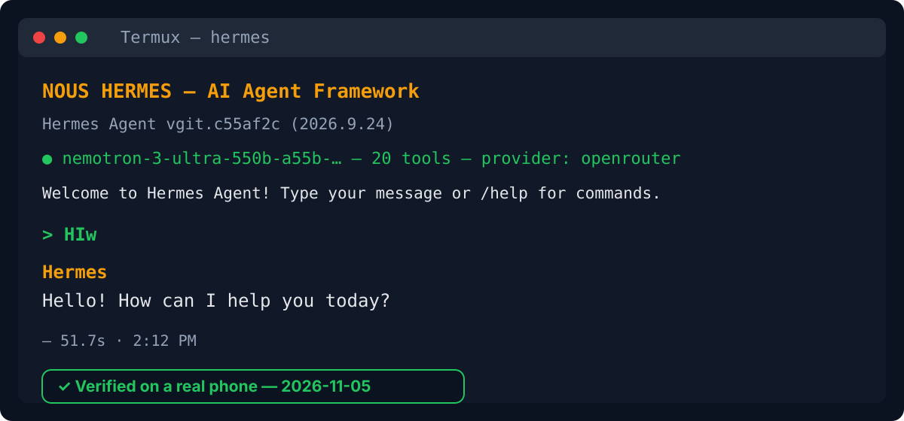

# 🚀 W8BDCR Hermes — The Free AI Agent

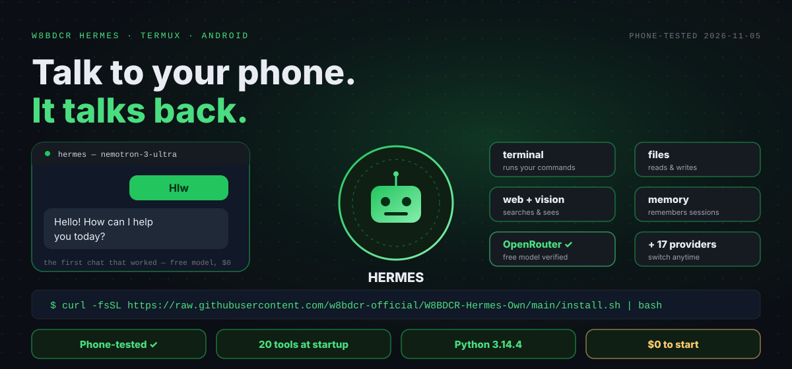

### 💰 $0 to Start — Free Providers

No token total to claim here — Hermes is free to run because its providers are free. OpenRouter's `:free` models, Atria's free preview and Inception's signup grant all cost $0 and need no card. What each provider charges (or doesn't) is that provider's own free tier, and free quotas change with providers — the setup list below is the source of truth.

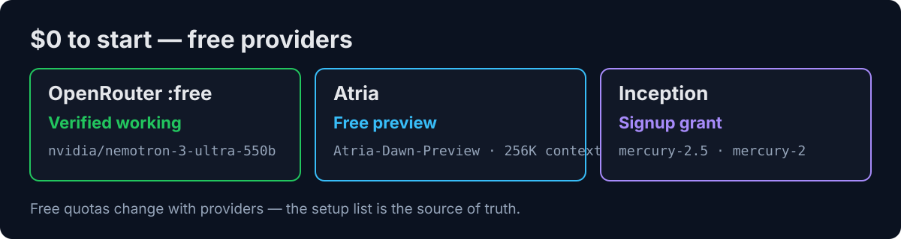

### ⭐ Star the repo if W8BDCR Hermes helped you

### 💬 Join the community

[](https://t.me/BDCRTEAM) [](https://t.me/BDCRTEAM) [](https://t.me/BDCRTEAM) [](https://w8bdcr.de5.net)

Questions, provider tips, roadmap & support → [@BDCRTEAM](https://t.me/BDCRTEAM) · [@w8bdcrteam](https://youtube.com/@w8bdcrteam) · @w8bdcraibot · @w8appstorebot

## 📈 The Agent Keeps Growing

|  | Before the fix | **Phone test 2026-11-05** |
|---|---|---|
| 🐍 Python in the venv | 3.13 → zero deps installed, setup crashed | **3.14.4 — enforced via uv** |
| 🖼️ Pillow conflict | 13 vs 12, unresolvable by pip | **Resolved via uv --override** |
| 💬 Chat | Never tested on a phone | **✅ Answered — OpenRouter :free** |
| 🧠 Tools at startup | — | **20 tools** |

**→ Next — Atria & Inception providers, then the OmniRoute link-up**

*Note: these are this installer repo's own numbers, from the real phone test on 2026-11-05 — your install shows its own live numbers at startup.*

## 🧭 Available

  

| **🚀 Start** | Quick Start | 📦 Install | 🆓 Gateway first |
|---|---|---|---|
| **💡 Learn** | 💥 The Promise | 🤔 Why Hermes | 🏆 What Sets Apart |
| **⚙️ Features** | 🎯 Modes | 🌐 Providers | 🔌 CLI & Tools |
|  | 🗜️ Run It Free | 🖥️ Where It Runs | 🔒 Private |
| **👀 See it** | 🎬 In Action | ✨ What's New | 🤖 Providers & Tools |
| **💚 Support** | 💚 Support | 💬 Community | 💖 Sponsors |
| **📦 Project** | 🛠️ Tech Stack | 📖 Docs | 👥 Contributors |

<div align="center">
  <b>🌐 In 43 languages</b>
  <br><br>
  
  
  
  
  
  
  
  
  
  
  
  
  
  
  
  
  
  
  
  
  
  
  
  
  
  
  
  
  
  
  
  
  
  
  
  
  
  
</div>

*Hermes answers in the language you write in — write to it in any of the languages above and it replies in the same language. There are no translated docs; the agent itself does the talking.*

## 🆓 Works the second you chat — one command

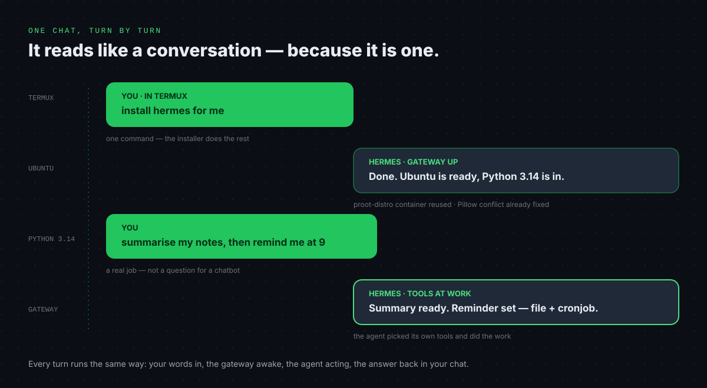

```
hermes chat -q "Hello!"
```

One question, no chat loop — the agent answers and exits. (Tip from the agent itself at startup: `hermes chat -q "query"` runs a single non-interactive query and exits.)

# 💥 The Promise

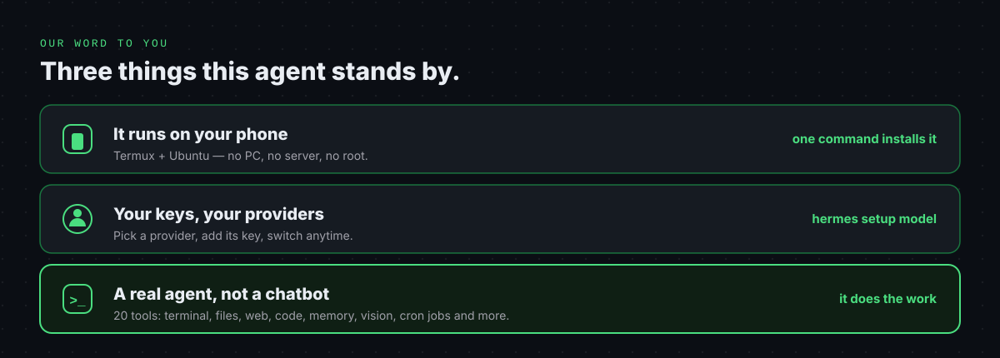

# 🤔 Why Hermes?

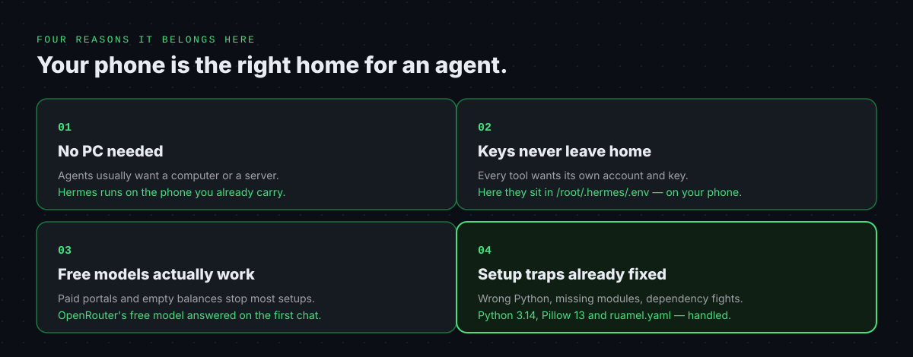

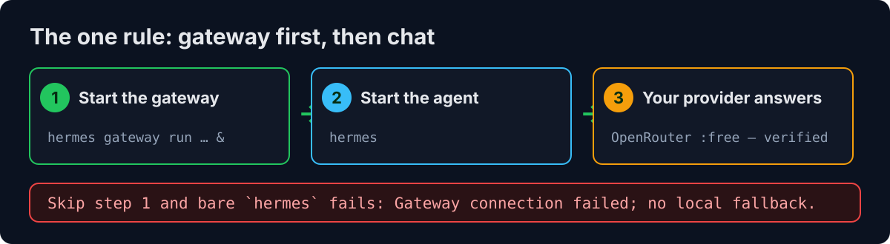

## 🤝 Supported by our Open Source Friends

No corporate backers yet — this project is kept free by W8BDCR. The one friend that makes it possible is the upstream project itself:

<table>
  <tr>
    <td align="center" width="150">
      
      <br><b>NousResearch</b><br><sub>Upstream Hermes Agent</sub><br><br>
      
    </td>
    <td>
      Thanks to <b>NousResearch</b>, the team behind the open-source Hermes Agent, for building the agent this installer sets up. Hermes Agent is the AI agent framework — twenty tools, a local gateway, memory, skills and scheduled jobs — downloaded fresh at install time. This repo holds only W8BDCR's own Termux installer for it; the agent itself is not claimed as ours.
    </td>
  </tr>
</table>

Want to back Hermes? Star the repo, or talk to us on Telegram — see Support below.

## 🎯 Modes — The Flagship

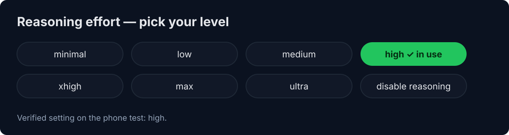

### ⚡ Pick your reasoning — eight levels

Call it reasoning effort and let the agent think as hard as the job needs.

### 🔀 Or switch provider anytime — 18 in the setup list

minimal · low · medium · high · xhigh · max · ultra · disable reasoning

Reasoning levels include high (the verified setting on the phone test) and every level below and above it — pick in `hermes setup model`.

### 🧱 Three fallbacks, built in

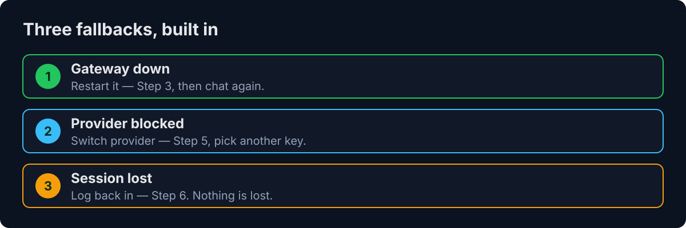

## 🏆 What Sets Hermes Apart

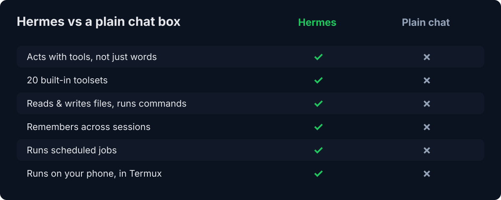

## 💚 Support Hermes

Hermes is MIT-licensed and maintained in the open. If it saves you time or money, here's how to keep it independent — pick whatever fits you.


**📱 Scan to contact @W8BDCR directly on Telegram** — point your camera at the QR code and it opens a chat with us.

| Way to support | What it is | Link |
|---|---|---|
| ⭐ **Star the repo** | Free — genuinely helps visibility | [Star W8BDCR-Hermes-Own](https://github.com/w8bdcr-official/W8BDCR-Hermes-Own) |
| 💬 **Telegram channel** | Updates, new tools and video links — scan the QR or tap | [@BDCRTEAM](https://t.me/BDCRTEAM) |
| 🌐 **Website** | All W8BDCR projects in one place | [w8bdcr.de5.net](https://w8bdcr.de5.net) |

No payment numbers are published here — support is via Star and Telegram only.

<br clear="right">

🐛 Found a bug or have feedback? Open an issue on the repo.

## 📡 Agent Status

The agent tells you it is alive the moment it starts — the startup line shows the model, the tool count and the provider:

```
nemotron-3-ultra-550b-a55b-… — 20 tools — provider: openrouter
```

If that line is missing, the gateway is not running — run any `hermes` command and it starts itself (Quick Start, Step 3).

## ✨ What's New

Recent highlights from the phone test on **2026-11-05**. Full history in the repo.

- **📱 Phone-tested end to end** — the installer was run on a real Android phone in Termux; OpenRouter's free model answered in chat.
- **🐍 Python 3.14 fix** — the installer now requires Python 3.14+ and fetches it with `uv` when the system Python is older. A 3.13 venv used to install zero dependencies and crash `hermes setup`.
- **🖼️ Pillow conflict fix** — `uv pip install --override` pins `pillow==13.0.0`, resolving the upstream `Pillow==13` vs `browser-harness` `pillow==12.3.0` conflict.
- **🎛️ `[termux]` profile first** — the installer installs the Termux extras before anything else, so desktop extras that cannot build on Android are never pulled in.
- **📦 `ruamel.yaml` fix** — installed explicitly so `hermes setup` no longer crashes on first run.
- **🤖 OpenRouter verified** — the free model `nvidia/nemotron-3-ultra-550b-a55b:free` answered "HIw" with "Hello! How can I help you today?" — 20 tools loaded, reasoning high.
- **🚀 `hermes-start` and `hermes-fix` (new — phone test pending)** — `hermes-start` runs the whole project from one small command (gateway + chat), and `hermes-fix` repairs a stuck setup and re-opens setup from where it stopped, without wiping your config. And now any `hermes` command starts the gateway itself when needed — no server-starting hassle at all.

## 🤖 Compatible CLIs & Coding Agents

One agent — 18 providers in the setup list and 17 toolsets built in.

### 🏢 Providers, Side by Side

<div align="center">
<table>
  <tr>
    <td align="center" width="76"><br><sub><b>OpenRouter</b></sub><br><sub>✅ Verified</sub></td>
    <td align="center" width="76"><br><sub><b>LarpRouter</b></sub><br><sub>⚠️ Blocked</sub></td>
    <td align="center" width="76"><br><sub><b>Atria</b></sub><br><sub>🔜 Key ready</sub></td>
    <td align="center" width="76"><br><sub><b>Inception</b></sub><br><sub>🔜 Key ready</sub></td>
    <td align="center" width="76"><br><sub><b>Groq</b></sub><br><sub>⛔ No signup</sub></td>
    <td align="center" width="76"><br><sub><b>Nous</b></sub><br><sub>💳 0 credits</sub></td>
  </tr>
  <tr>
    <td align="center" width="76"><br><sub><b>DeepSeek</b></sub><br><sub>via LarpRouter</sub></td>
    <td align="center" width="76"><br><sub><b>OpenAI</b></sub><br><sub>Compatible</sub></td>
    <td align="center" width="76"><br><sub><b>Anthropic</b></sub><br><sub>Not set up</sub></td>
    <td align="center" width="76"><br><sub><b>Kimi</b></sub><br><sub>In setup list</sub></td>
    <td align="center" width="76"><br><sub><b>xAI</b></sub><br><sub>In setup list</sub></td>
    <td align="center" width="76"><br><sub><b>Fireworks</b></sub><br><sub>In setup list</sub></td>
  </tr>
  <tr>
    <td align="center" width="76"><br><sub><b>Novita</b></sub><br><sub>In setup list</sub></td>
    <td align="center" width="76"><br><sub><b>MiniMax</b></sub><br><sub>In setup list</sub></td>
    <td align="center" width="76"><br><sub><b>Qwen</b></sub><br><sub>In setup list</sub></td>
    <td align="center" width="76"><br><sub><b>Ollama</b></sub><br><sub>In setup list</sub></td>
    <td align="center" width="76"><br><sub><b>vLLM</b></sub><br><sub>In setup list</sub></td>
    <td align="center" width="76"><br><sub><b>z.ai / GLM</b></sub><br><sub>In setup list</sub></td>
  </tr>
</table>
</div>

**+ also works with:** your own endpoint · **any OpenAI-compatible API**

### 🧰 Seventeen Toolsets, One Agent

<div align="center">
<table>
  <tr>
    <td align="center" width="76"><br><sub><b>browser</b></sub><br><sub>&nbsp;</sub></td>
    <td align="center" width="76"><br><sub><b>clarify</b></sub><br><sub>&nbsp;</sub></td>
    <td align="center" width="76"><br><sub><b>code_execution</b></sub><br><sub>&nbsp;</sub></td>
    <td align="center" width="76"><br><sub><b>computer_use</b></sub><br><sub>&nbsp;</sub></td>
    <td align="center" width="76"><br><sub><b>connections</b></sub><br><sub>&nbsp;</sub></td>
    <td align="center" width="76"><br><sub><b>cronjob</b></sub><br><sub>&nbsp;</sub></td>
  </tr>
  <tr>
    <td align="center" width="76"><br><sub><b>delegation</b></sub><br><sub>&nbsp;</sub></td>
    <td align="center" width="76"><br><sub><b>file</b></sub><br><sub>&nbsp;</sub></td>
    <td align="center" width="76"><br><sub><b>image_gen</b></sub><br><sub>&nbsp;</sub></td>
    <td align="center" width="76"><br><sub><b>memory</b></sub><br><sub>&nbsp;</sub></td>
    <td align="center" width="76"><br><sub><b>session_search</b></sub><br><sub>&nbsp;</sub></td>
    <td align="center" width="76"><br><sub><b>skills</b></sub><br><sub>&nbsp;</sub></td>
  </tr>
  <tr>
    <td align="center" width="76"><br><sub><b>terminal</b></sub><br><sub>&nbsp;</sub></td>
    <td align="center" width="76"><br><sub><b>todo</b></sub><br><sub>&nbsp;</sub></td>
    <td align="center" width="76"><br><sub><b>tts</b></sub><br><sub>&nbsp;</sub></td>
    <td align="center" width="76"><br><sub><b>vision</b></sub><br><sub>&nbsp;</sub></td>
    <td align="center" width="76"><br><sub><b>web</b></sub><br><sub>&nbsp;</sub></td>
  </tr>
</table>
</div>

| Toolset | What it does |
|---|---|
| `browser` | Browse the web from the agent |
| `clarify` | Asks you when a request is unclear |
| `code_execution` | Runs code |
| `computer_use` | Uses the computer on your behalf |
| `connections` | Talks to connected services |
| `cronjob` | Scheduled jobs |
| `delegation` | Hands work to sub-agents |
| `file` | Reads and writes files |
| `image_gen` | Generates images |
| `memory` | Remembers across sessions |
| `session_search` | Searches past sessions |
| `skills` | Loads extra skills |
| `terminal` | Runs terminal commands |
| `todo` | Tracks tasks |
| `tts` | Text to speech |
| `vision` | Sees images |
| `web` | Web search and fetch |

20 tools load at startup across these 17 toolsets — that is the line the phone test showed.

## 🧠 Unique Models — Theirs + W8BDCR Picks

### Theirs — from the upstream `hermes model` provider list (18 providers)

| Category | Providers |
|---|---|
| Verified working | OpenRouter |
| Key in hand, not yet installed | Atria, Inception |
| Blocked | LarpRouter (billing), Groq (signup) |
| Paid, 0 credits | Nous Portal |
| Via another provider | DeepSeek (via LarpRouter) |
| Compatible wire format | OpenAI-compatible APIs |
| In the setup list, not yet set up | Anthropic, Kimi, xAI, Fireworks, Novita, MiniMax, Qwen, Ollama, vLLM, z.ai / GLM |

### W8BDCR Picks — unique models we tested or hold keys for

| Model | Why it's unique | Best for |
|---|---|---|
| `nvidia/nemotron-3-ultra-550b-a55b:free` (OpenRouter) | Free model, 1M context, verified working in chat on the phone test | Free chat, coding |
| `deepseek-v4.1-flash-1017-non-abliterated` (LarpRouter) | DeepSeek V4.1 Flash, non-abliterated — configured, but the account balance is $0 | Blocked until topped up |
| `Atria-Dawn-Preview` (Atria) | 744B MoE agentic model, 256K context, free preview | Agentic work |
| `mercury-2.5` / `mercury-2` (Inception) | Diffusion-based chat models, signup grant | Fast chat |

*Statuses are from the phone test and the keys in hand — a provider marked "not yet set up" has no key on file, so the setup list is the source of truth.*


## 🌐 All Providers — 18 (in the setup list)

Every provider in the upstream `hermes model` setup list, grouped by status. `hermes setup model` is the live source — pick, paste a key and test each one there.

### Verified (1)

| Provider | Model | Status |
|---|---|---|
| OpenRouter | `nvidia/nemotron-3-ultra-550b-a55b:free` | ✅ Working — verified 2026-11-05. Answered chat with 20 tools loaded. Reasoning: high. |

### Key in hand (2)

| Provider | Model | Status |
|---|---|---|
| Atria | `Atria-Dawn-Preview` | 🔜 Key in hand, not yet installed. Next to try — free preview, OpenAI-compatible. |
| Inception | `mercury-2.5` / `mercury-2` | 🔜 Key in hand, not yet installed. Note: `mercury-edit-2` is edit-only and does not work for chat. |

### Blocked (2)

| Provider | Model | Status |
|---|---|---|
| LarpRouter (OpenAI-compatible) | `deepseek-v4.1-flash-1017-non-abliterated` | ⚠️ Configured, billing-blocked. Chat returns HTTP 402 `Insufficient account credit` — the account balance is $0 and needs a top-up (minimum $1). |
| Groq | — | ⛔ Signup blocked. `console.groq.com` refuses signup with "We couldn't complete your sign-up" on both Google and GitHub login. |

### Paid (1)

| Provider | Model | Status |
|---|---|---|
| Nous Portal | — | 💳 Paid, 0 credits. The portal account shows no credits available; no card on file, so this path is closed for now. |

### Via another provider (1)

| Provider | Model | Status |
|---|---|---|
| DeepSeek | `deepseek-v4.1-flash-1017-non-abliterated` | Via LarpRouter — same billing block as above. |

### Compatible (1)

| Provider | Model | Status |
|---|---|---|
| OpenAI | Any OpenAI-compatible API | Hermes speaks the OpenAI wire format — point it at any compatible endpoint. |

### Not yet set up (10)

| Provider | Model | Status |
|---|---|---|
| Anthropic | — | In the upstream `hermes model` provider list (Claude via OAuth or API key). Not yet set up. |
| Kimi | — | In the setup list. Not yet set up. |
| xAI | — | In the setup list. Not yet set up. |
| Fireworks | — | In the setup list. Not yet set up. |
| Novita | — | In the setup list. Not yet set up. |
| MiniMax | — | In the setup list. Not yet set up. |
| Qwen | — | In the setup list. Not yet set up. |
| Ollama | — | In the setup list. Not yet set up. |
| vLLM | — | In the setup list. Not yet set up. |
| z.ai / GLM | — | In the setup list. Not yet set up. |

### Next: Route Hermes Through Your Own OmniRoute

Point Hermes at the already-running W8BDCR OmniRoute server (`http://localhost:20128/v1`, model `auto`) and reach every provider OmniRoute has through one local endpoint — no per-provider Hermes setup. **Planned, not yet set up.**

## 🌐 AI Providers

### 🏢 Every major lab — through one agent

<div align="center">
<table>
  <tr>
    <td align="center" width="76"><br><sub><b>OpenAI</b></sub><br><sub>&nbsp;</sub></td>
    <td align="center" width="76"><br><sub><b>Anthropic</b></sub><br><sub>&nbsp;</sub></td>
    <td align="center" width="76"><br><sub><b>DeepSeek</b></sub><br><sub>&nbsp;</sub></td>
    <td align="center" width="76"><br><sub><b>Groq</b></sub><br><sub>&nbsp;</sub></td>
    <td align="center" width="76"><br><sub><b>Qwen</b></sub><br><sub>&nbsp;</sub></td>
    <td align="center" width="76"><br><sub><b>MiniMax</b></sub><br><sub>&nbsp;</sub></td>
  </tr>
  <tr>
    <td align="center" width="76"><br><sub><b>xAI</b></sub><br><sub>&nbsp;</sub></td>
    <td align="center" width="76"><br><sub><b>Kimi</b></sub><br><sub>&nbsp;</sub></td>
    <td align="center" width="76"><br><sub><b>Fireworks</b></sub><br><sub>&nbsp;</sub></td>
    <td align="center" width="76"><br><sub><b>Novita</b></sub><br><sub>&nbsp;</sub></td>
    <td align="center" width="76"><br><sub><b>Ollama</b></sub><br><sub>&nbsp;</sub></td>
    <td align="center" width="76"><br><sub><b>vLLM</b></sub><br><sub>&nbsp;</sub></td>
  </tr>
</table>
</div>

…and more — every provider in the setup list is in the table above.

### 🆓 Free Forever — $0, no card

<div align="center">
<table>
  <tr>
    <td align="center" width="76"><br><sub><b>OpenRouter</b></sub><br><sub>:free models, verified</sub></td>
    <td align="center" width="76"><br><sub><b>Atria</b></sub><br><sub>Free preview</sub></td>
    <td align="center" width="76"><br><sub><b>Inception</b></sub><br><sub>Signup grant</sub></td>
    <td align="center" width="76"><br><sub><b>Groq</b></sub><br><sub>Free tier, signup blocked</sub></td>
    <td align="center" width="76"><br><sub><b>Ollama</b></sub><br><sub>Local, in setup list</sub></td>
    <td align="center" width="76"><br><sub><b>OpenAI-compatible</b></sub><br><sub>Any free endpoint</sub></td>
  </tr>
</table>
</div>

Full status table → `All Providers` above.

## 🖥️ Where Hermes Runs — Anywhere

| Platform | Install | Highlights |
|---|---|---|
| 📱 Android (Termux) | `curl -fsSL https://raw.githubusercontent.com/w8bdcr-official/W8BDCR-Hermes-Own/main/install.sh \| bash` | Runs on your phone, no root — this installer |
| 🐧 Ubuntu container | Created by the installer (`proot-distro`) | Full Ubuntu inside Termux, reused on re-runs |
| 🖥️ Desktop (upstream) | See the upstream Hermes Agent docs | The same agent, installed from source on a PC |

### 🧩 New: Hermes inside your own OmniRoute gateway

Point Hermes at http://localhost:20128/v1 and let your own OmniRoute server feed it models.

## 🔒 Private & Local-First

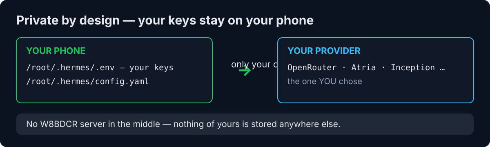

## 🔌 Full CLI

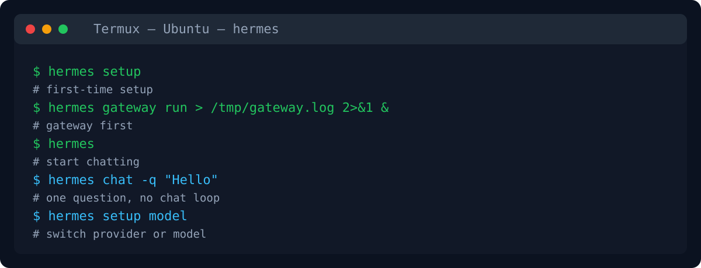

### ⌨️ A real CLI (not just start)

`hermes-start`, `hermes-fix`, `hermes setup`, `hermes gateway run`, `hermes`, `hermes chat -q`, `hermes setup model` — the whole agent from seven commands, and any `hermes` command starts the gateway itself when needed.

### 🤝 Connect an agent — and it delegates for you

The `delegation` toolset hands work to sub-agents from inside a session, and `skills` loads extra abilities on demand.

## 🆓 Run It Free — No Card

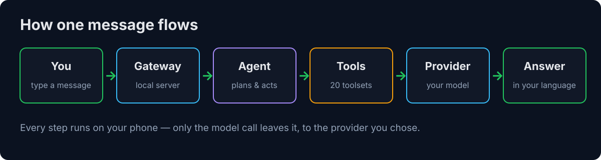

### 📖 How it works — one message, start to finish

You type in Termux, the gateway wakes the agent, the agent plans with its 20 tools, and the model you chose answers. Free providers are listed above — what each one gives for free is that provider's own free tier, and free quotas change with providers.

# ⚡ Quick Start

Three steps. After setup, just use it — any `hermes` command starts the server itself when needed.

## STEP 1 · Install the agent

```bash
# ══ STEP 1 · Install the agent ══
# › One command in Termux — downloads and runs the W8BDCR installer.
# › It reuses your Ubuntu container and your existing setup if you run it again.
# › Already installed? Re-run this once — it updates in place
# › and adds hermes-start and hermes-fix — plus every hermes command
# › now starts the gateway itself when needed.
curl -fsSL https://raw.githubusercontent.com/w8bdcr-official/W8BDCR-Hermes-Own/main/install.sh | bash
```

## STEP 2 · First-time setup

```bash
# ══ STEP 2 · First-time setup ══
# › Run this once, after the install finishes.
# › It walks you through provider, model and reasoning effort.
# › Messaging can be skipped and telemetry declined — both were skipped in the phone test.
hermes setup
```

> 💡 Tip: the setup model list shows paid models only. For a free model, choose **Enter custom model name** and type the full model id — that is how the verified OpenRouter free model was set.

## STEP 3 · Just use it — any command works

```bash
# ══ STEP 3 · Just use it — the server starts itself ══
# › Any hermes command just works — the gateway starts itself
# › when needed, then your command runs. No server to start by hand.
# › Session died? Just run hermes again — your setup is kept.
# › Want the full run in one go? hermes-start does gateway + chat together.
hermes
```

### 📦 More commands

| Command | What it does |
|---|---|
| `hermes gateway run > /tmp/gateway.log 2>&1 &` | Gateway on its own (only if you run the pieces separately) |
| `hermes` | Chat — the gateway starts itself when needed |
| `hermes-start` | Explicit full run — gateway + chat in one command |
| `hermes setup model` | Switch provider or model anytime |
| `hermes-fix` | Setup stuck? Repairs it and re-opens setup from where it stopped |
| `proot-distro login ubuntu` | Log back into Ubuntu by hand (after a dead session) |
| `curl -fsSL https://raw.githubusercontent.com/w8bdcr-official/W8BDCR-Hermes-Own/main/uninstall.sh \| bash` | Uninstall — asks before deleting anything |

### 📦 More install methods — from source (upstream)

This installer targets Termux on Android. To install the upstream agent itself from source on another machine, see the upstream Hermes Agent docs at https://github.com/NousResearch/hermes-agent.

### ⚡ Updating

The installer has no separate updater — re-running the install command updates the agent in place and reuses your Ubuntu container and your existing setup.

# 🎬 Hermes in Action

Made a video about Hermes? Open an issue with the link — we'll feature it here. W8BDCR's own demo videos will be added here as they are published.

# 📧 Community & Help

| Channel | Where / how |
|---|---|
| 💬 Telegram — W8BDCR community | https://t.me/BDCRTEAM |
| 🎬 YouTube — W8BDCR team | https://youtube.com/@w8bdcrteam |
| 🤖 Telegram bot | @w8bdcraibot |
| 🛒 Telegram app store bot | @w8appstorebot |
| 🐙 GitHub | https://github.com/w8bdcr-official |
| 📦 Source code | https://github.com/w8bdcr-official/W8BDCR-Hermes-Own |
| 🐛 Report a bug | Open an issue on the repo |
| 🤝 Contribute | See below |
| 💚 Support the project | See Support section above |

## 🛠️ Tech Stack

| Layer | Stack |
|---|---|
| Installer | bash, proot-distro, uv, Python 3.14 |
| Agent | Upstream open-source Hermes Agent (downloaded fresh at install) |
| Container | Ubuntu inside Termux (proot-distro) |
| Config | `/root/.hermes/config.yaml` + `/root/.hermes/.env` |
| Providers | OpenRouter (verified), LarpRouter, Atria, Inception — see All Providers above |
| Companion | W8BDCR OmniRoute — local AI gateway (planned link-up) |

## 📖 Documentation

| Doc | Where |
|---|---|
| Getting Started | README Install & Quick Start |
| The moving parts | `docs/diagrams/` |
| Who powers your agent | All Providers above |
| When something breaks | Troubleshooting below |
| Project & Quality | LICENSE |

### 📘 Getting Started

Start with Install & run, then Quick Start — after setup, just run any `hermes` command; the server starts itself.

### 🔄 The Moving Parts

Termux → Ubuntu container → Python 3.14 venv → Hermes Agent → gateway → your provider. Diagrams in `docs/diagrams/`.

### 🧠 Who Powers Your Agent

Verified statuses are in the providers table above. A provider marked "not yet installed" has its key in hand and will be added next.

### 🩺 When Something Breaks

| Problem | Cause | Fix |
|---|---|---|
| `Gateway connection failed; no local fallback` | The gateway is not running | Just run any `hermes` command — it starts the gateway itself, then runs your command (see Quick Start above) |
| `hermes setup` crashes with `No module named 'ruamel'` / `'dotenv'` | The venv was built with Python 3.13 or older — upstream deps are pinned to Python 3.14+, so pip installed zero dependencies | The installer now enforces Python 3.14+ (via `uv` when needed). Re-run the installer. |
| Install fails on a Pillow conflict | Upstream core pins `Pillow==13.0.0` while `browser-harness` requires `pillow==12.3.0` | The installer resolves it with `uv pip install --override` (`pillow==13.0.0`) and installs the `[termux]` profile first. Re-run the installer. |
| Chat returns HTTP 402 `Insufficient account credit` | The provider account balance is $0 (seen with LarpRouter) | Top up that provider, or switch provider with `hermes setup model` — OpenRouter's free model is verified working. |
| Session died and setup seems lost | It is not lost — only the session ended | Just run `hermes` again — the gateway starts itself and the chat opens. Config and keys are still in `/root/.hermes/`. |
| Signup refused at a provider (seen with Groq) | The provider blocks the signup on its side | Try a different login method or network later, or use a provider whose key you already have. |

### 📋 Project & Quality

Contributing and licence notes are in the repo root.

# ⭐ Top Contributors

| Contributor | Role |
|---|---|
| W8BDCR | Installer, uninstaller, README |

### External contributors by merged pull requests

Listed from merged pull requests to this installer repo.

### GitHub-attributed commits

Listed from GitHub commit attribution for this repo.

## 💖 Sponsors

No sponsors yet — this project is kept free by W8BDCR. If it helps you, star the repo or talk to us on Telegram — see Support above.

## 👥 Contributors

[](https://github.com/w8bdcr-official/W8BDCR-Hermes-Own/graphs/contributors)

*This repo's own contributor grid — it fills in as contributors arrive.*

| Contributor | Role |
|---|---|
| W8BDCR | Installer, uninstaller, README |

### How to Contribute

1. Fork the repository
2. Branch from `main`
3. Create your feature branch (`git checkout -b feat/amazing-feature`)
4. Commit your changes (`git commit -m 'feat: add amazing feature'`)
5. Push to the branch (`git push origin feat/amazing-feature`)
6. Open a Pull Request

### Updating the Installer

```
# Edit install.sh, test it on a real Termux phone, then commit
git commit -m 'fix: ...'
```

## 📊 Stars

[](https://www.star-history.com/?repos=w8bdcr-official%2FW8BDCR-Hermes-Own&type=date)

Star history for this repo — the chart fills in as stars arrive. See the live chart at [star-history.com](https://www.star-history.com/?repos=w8bdcr-official%2FW8BDCR-Hermes-Own&type=date).

## 🌍 StarMapper

[](https://starmapper.bruniaux.com/w8bdcr-official/W8BDCR-Hermes-Own)

*The map is generated from this repo's own stargazers, so it fills in as stars arrive.*

## 🙏 Acknowledgments

The agent is upstream open-source software. The projects below are what this installer is built on.

| Project | Note |
|---|---|
| [Hermes Agent — NousResearch](https://github.com/NousResearch/hermes-agent) | The upstream open-source agent this installer sets up |
| [Termux](https://termux.dev) | The Android terminal this runs in |
| [proot-distro](https://github.com/termux/proot-distro) | The Ubuntu container inside Termux |
| [Python](https://www.python.org) | 3.14+ runtime for the agent |
| [uv](https://github.com/astral-sh/uv) | Fast Python installer used by the installer |

## 📄 License

MIT License - see [LICENSE](LICENSE) for details.

**Attribution note:** this repo holds W8BDCR's own installer code. The agent it installs is the upstream open-source Hermes Agent project by NousResearch, downloaded fresh from https://github.com/NousResearch/hermes-agent at install time — it is not claimed as W8BDCR's work.

---

**[⬆ Back to top](#-1-install--run) · Built with ❤️ for the open-source AI community.**

W8BDCR Hermes · Termux · MIT License
